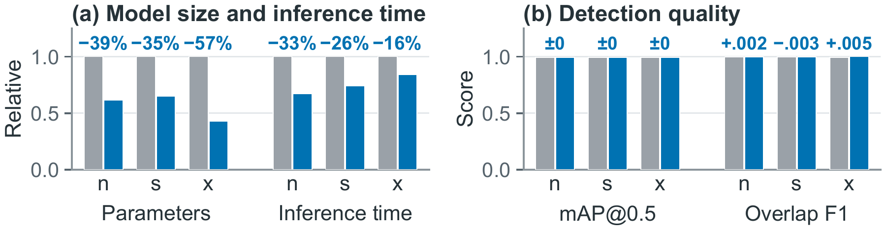
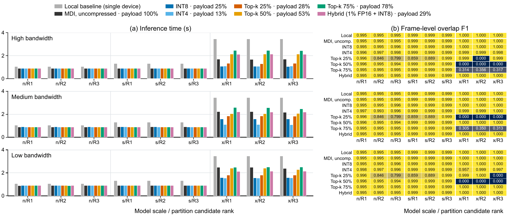

# CBRS-CEDAR-MDI

**Code, pretrained models and experiment data for CEDAR.**

**[Communication-Efficient Model-Distributed Inference for CBRS Radar Detection at the Edge](https://arxiv.org/abs/2611.00625)**

Teng Li and Hulya Seferoglu, University of Illinois Chicago. Submitted to ICC 2027.

**[Full paper with appendix on arXiv](https://arxiv.org/abs/2611.00625)** |
**[Direct PDF](https://uic-networking-research-lab.github.io/CEDAR-LongVersionPaper/CEDAR-WithAppendix.pdf)**

CEDAR (Communication-Efficient, Edge-Distributed Architecture for Radar detection)
detects radar and LTE signals in spectrograms and accelerates the raw-I/Q detection
pipeline on edge devices. **CEDAR-YOLO** removes the multi-scale fusion neck and two
of the three detection scales, enabling single-tensor partition boundaries.
**CEDAR-MDI** combines activation compression with offline, compression-aware
partition selection to minimize the pipeline bottleneck.

## Core results

| Experiment | Result reported in the paper |
|---|---|
| Original YOLO | YOLOv8, YOLO11 and YOLO26 achieve overlap F1 above **0.99**; their multi-scale structures incur high activation-transfer costs under MDI. |
| CEDAR-YOLO | **35-57% fewer parameters** and **16-33% less model inference time** than same-scale YOLOv8, with matching mAP@0.5 and overlap F1 differences below 0.006. |
| CEDAR-MDI | Up to **3.27x single-device throughput** with unchanged overlap F1; the top-ranked candidates reach up to **3.21x**. |

Training and the architecture-quality sweep use the **PC GPU**. Local speed
baselines and all MDI measurements use **Jetson Orin Nano CPUs in FP32**.
The following figures reproduce the submitted paper's comparisons.

### CEDAR-YOLO: model size, computation and quality



The 20 x 20, full-coverage detector reduces parameters and model computation
while preserving detection quality. Gray denotes YOLOv8; blue denotes CEDAR-YOLO.

### CEDAR-MDI: throughput and overlap detection



Left: inference time per completed frame (**1 / throughput**); right: overlap F1.
R1-R3 are the three offline-ranked candidates for each model, bandwidth environment
and compressor. The best throughput gain uses extra-large CEDAR-YOLO with INT8.
Top-k sparsification can substantially reduce detection quality. Throughput gains
are summarized for runs within 0.01 overlap F1 of local inference; all candidates
remain visible in the figure. This throughput metric is distinct from end-to-end delay.

See the [core experiment summary](results/REPORT.md), [source data](results/README.md),
and [full paper with appendix](https://arxiv.org/abs/2611.00625) for the experiment
protocol and additional results. Reproduction guides:
[original YOLO](docs/1_yolo.md), [CEDAR-YOLO](docs/2_cedar_yolo.md),
[original-YOLO MDI](docs/3_yolo_mdi.md), and [CEDAR-MDI](docs/4_cedar_mdi.md).

## Experiment environments

| Experiment | Platform and environment | Work performed |
|---|---|---|
| Model training and CEDAR-YOLO quality evaluation | Windows PC, Python 3.12, CUDA GPU | Train original YOLO and CEDAR-YOLO; evaluate CEDAR feature-grid/coverage configurations on PNGs |
| Local speed baseline | One Jetson Orin Nano, L4T r36.4.0, Python 3.12, CPU FP32 | Measure the raw-I/Q pipeline and individual stages on one device |
| Model-distributed inference | Multiple Jetson Orin Nano devices, same Jetson environment, CPU FP32 | Run original-YOLO MDI and CEDAR-MDI over Wi-Fi, including compression and partition-policy comparisons |

These are recommended, tested environments, not a requirement to match every
general-purpose library version. **Raw-I/Q preprocessing is the exception: preserve
the renderer's library versions and parameters, and check pixels against the supplied PNGs.**

| Component | PC: training / CEDAR quality | Jetson: local baseline / MDI |
|---|---|---|
| Python | 3.12.13 | 3.12 |
| PyTorch / torchvision | 2.7.1+cu128 / 0.22.1+cu128 | 2.7.0 / 0.22.0, Jetson-compatible builds |
| Ultralytics | 8.4.46 | 8.4.46, CBRS detector dependency |
| NumPy / SciPy | 2.2.4 / 1.14.1 | 2.2.4 / 1.17.1 |
| Matplotlib / Pillow | 3.10.8 / 11.2.1 | 3.10.8 / 11.2.1 |
| Flask / Werkzeug | 3.0.3 / 3.0.4; only needed for local transport checks | 3.1.3 / 3.1.6 |
| requests / tqdm | 2.32.3 / 4.66.5 | 2.32.3 / 4.67.1 |

The [Jetson guide](docs/3_yolo_mdi.md#environment-on-every-node) links the shared
CAMDI environment and gives the multi-device setup. PC functional MDI checks do
not provide the paper's Jetson timing results. The CEDAR quality sweep and Jetson
timing also use different checkpoint editions; see [weights](docs/weights.md).

## Quick start: use our PNGs and pretrained models

**For a quick CEDAR-YOLO quality test, download the assets below and use our
already-converted spectrogram PNGs.** They include labels and the fixed
train/validation/test split; no raw-I/Q download or preprocessing is needed.
Use the latest PC checkpoints for CEDAR-YOLO quality evaluation:

```bash
# After installing dependencies and the assets as described below:
python reproduce.py --task png --weights latest --device 0 --models sig_yolo_v8n_f20t20_c100
```

Download the [Genesys Lab over-the-air CBRS dataset](https://genesys-lab.org/CBRS)
only if you need the original raw-I/Q frames, want to regenerate spectrograms,
or want to test the full pipeline starting with preprocessing (including Jetson
local/MDI timing). **The original recordings do not come with our train,
validation and test partitions.** Restore them using our
[fixed split list](splits/cbrs_split.csv), also supplied as `splits.csv` in the
assets. Do not generate a new random split when reproducing the reported results.
See [raw-data preparation](docs/data.md#5-build-the-raw-sigmf-split).

**[Download CBRS-CEDAR-MDI-ASSETS v1.0 from GitHub Releases](https://github.com/UIC-Networking-Research-Lab/CBRS-CEDAR-MDI/releases/tag/assets)**

1. Open the release's **Assets** list and download **all 9 archive parts**:
   `CBRS-CEDAR-MDI-ASSETS.7z.001` through `CBRS-CEDAR-MDI-ASSETS.7z.009`.
   Keep all parts in the same folder with their original names.
2. Use **7-Zip** to extract `CBRS-CEDAR-MDI-ASSETS.7z.001` only. It reads the remaining
   parts automatically; do not extract each part separately.
3. Place the extracted `CBRS-CEDAR-MDI-ASSETS` folder beside the repository:

```text
workspace/
  CBRS-CEDAR-MDI/
  CBRS-CEDAR-MDI-ASSETS/
    datasets/
    weights/
    splits.csv
    README.md
```

Alternatively, extract from the folder containing all parts with:

```bash
7z x CBRS-CEDAR-MDI-ASSETS.7z.001
```

GitHub's **Source code (zip/tar.gz)** downloads contain code, not the datasets or
weights. Use this project's asset package; the MDI and RT packages are independent.

From the repository root, prepare the environment and install the assets:

On the PC, use Python 3.12 and install platform-compatible PyTorch first.
You may use Conda or a virtual environment with any name and location.
`requirements.txt` supplies the remaining dependencies and selects the PC or
aarch64 Jetson SciPy rendering version.

```bash
pip install -r requirements.txt
python reproduce.py --assets ../CBRS-CEDAR-MDI-ASSETS --task install
python reproduce.py --task check --weights jetson
python reproduce.py --task png --weights jetson
```

The **CBRS-CEDAR-MDI-ASSETS** download contains `datasets/`, `weights/`, `splits.csv`
and a README. It includes all 640 × 640 PNGs, labels, fixed split membership and pretrained
weights, and is independent of the RT project's download. See the
[download guide](docs/download_bundle.md), [data](docs/data.md) and
[weights](docs/weights.md) for the layout. PNG evaluation requires no raw I/Q download.
The bundle also includes all **108 PC CEDAR quality/sweep checkpoints** from
`trained_models_cedar_best`. After installation, use `--weights latest --device 0`
for their PC evaluation. Never substitute one edition while comparing against another's results.

To evaluate only selected models:

```bash
python reproduce.py --task png --weights jetson --models cbrs_yolo8n sig_yolo_v8n_f20t20_c100
```

To predict a single image without running a benchmark:

```bash
python scripts/predict.py --weights trained_models/cbrs_yolo8n/weights/best.pt --image /path/to/sample.png
python scripts/predict.py --weights trained_models_mdi/sig_yolo_v8n_f20t20_c100/weights/best.pt --image /path/to/sample.png
```

## Preprocessing compatibility

**Parameters and library versions both matter.** Changing the FFT/window, overlap,
intensity scaling, clipping, colormap, orientation, image size, or rendering libraries
changes the spectrogram and can make the pretrained models unreliable.
**Use the supplied PNGs for reproduction; retrain your own model when using a different
preprocessing pipeline.** Keep training, calibration and deployment preprocessing identical.

Even a small rendering mismatch can invalidate pretrained-model predictions.
The checked PC renderer uses SciPy 1.14.1; Jetson uses 1.17.1. Both use NumPy
2.2.4, Matplotlib 3.10.8 and Pillow 11.2.1. Using the supplied PNGs avoids raw-I/Q
conversion; do not regenerate them with unverified settings.
[Preprocessing settings and pixel compatibility check](docs/preprocessing.md).

## Reproduce the paper pipelines

Run from the repository root. Add `--dry-run` to inspect a command without starting it.
New training writes `trained_models_retrained/`, keeping released weights intact.

| Task | Command |
|---|---|
| Train original YOLO | `python reproduce.py --task train-yolo` |
| Train CEDAR-YOLO | `python reproduce.py --task train-cedar` |
| Evaluate supplied PNGs | `python reproduce.py --task png --weights jetson` |
| Rebuild offline partition rankings | `python reproduce.py --task offline` |
| Original YOLO raw-I/Q local baseline | `python reproduce.py --task local-yolo` |
| CEDAR raw-I/Q local baseline | `python reproduce.py --task local-cedar --weights jetson` |

Raw-I/Q timing and MDI need the original recordings. Download the
[Genesys Lab over-the-air CBRS dataset](https://genesys-lab.org/CBRS), then restore the
**provided** train/validation/test split rather than choosing a new random split.
The original download contains recordings without these partitions; the command
below applies `splits/cbrs_split.csv` (the assets' `splits.csv`):

```bash
python reproduce.py --task raw-split --raw-source /path/to/IEEE_UPLOAD
python scripts/check_rendering.py --raw-source /path/to/IEEE_UPLOAD
```

For four-device MDI, follow the [Jetson setup and launch steps](docs/3_yolo_mdi.md#1-prepare-the-jetson-testbed).
Install the environment and weights on each node. Place the PNG
labels and raw test split on A. Start B, C and D before A, changing `--node` on each host:

```bash
python reproduce.py --task cedar-mdi --node B --hosts 192.168.1.20 192.168.1.21 192.168.1.22 192.168.1.23
```

Use `--task yolo-mdi` for the original-YOLO compression sweep. The framework selects
its saved offline-ranked partitions for CEDAR; [Part 4](docs/4_cedar_mdi.md) explains
profiling and reranking on your own hardware. A one-computer functional check is:

```bash
python reproduce.py --task cedar-mdi --local-nodes --models sig_yolo_v8n_f20t20_c100 --max-samples 2
```

This checks the four processes and tensor transfers; only runs on separate Jetsons
with the configured links reproduce the testbed timing conditions.

## Files and reference hardware

`cbrs/`: model, preprocessing, compressors and transport. `scripts/`: the four pipelines,
asset installer and checks. `configs/`: paper partitions and measured profiles.
`splits/cbrs_split.csv`: immutable split. `results/paper/`: numerical paper results.
`results/training_logs/`: released original-YOLO training logs.

The testbed has four Jetson Orin Nano 8 GB devices connected through 802.11ac Wi-Fi,
CPU FP32 execution, and high/medium/low bandwidth environments configured by token buckets.
The environment matches [CAMDI's Jetson testbed](https://github.com/UIC-Networking-Research-Lab/CAMDI_RC_MobiHoc2026_Fitting_and_Jetson):
L4T r36.4.0, Python 3.12, PyTorch 2.7.0 and torchvision 0.22.0.
The [Jetson guide](docs/3_yolo_mdi.md) covers library versions, asset installation,
raw-data restoration, networking, launch order, local baselines and result files.

## Citation and related work

```bibtex
@misc{li2026cedar,
  title = {Communication-Efficient Model-Distributed Inference for CBRS Radar Detection at the Edge},
  author = {Li, Teng and Seferoglu, Hulya},
  year = {2026},
  eprint = {2611.00625},
  archivePrefix = {arXiv},
  primaryClass = {cs.DC},
  url = {https://arxiv.org/abs/2611.00625}
}
```

Please also cite Tassie et al., *Detection of Co-existing RF Signals in CBRS Using ML:
Dataset and API-Based Collection Testbed*, IEEE Communications Magazine, 2023, when
using the dataset. Its original download, description and citation are on the
[dataset page](https://genesys-lab.org/CBRS).

[**CBRS-CEDAR-RT**](https://github.com/UIC-Networking-Research-Lab/CBRS-CEDAR-RT)
is a derivative project exploring GPU deployment of these pretrained detectors with
ONNX Runtime and TensorRT. Its GPU results are separate from this paper's CPU/MDI results.

## License

[GNU AGPL-3.0](LICENSE). Ultralytics also uses AGPL-3.0.
The original dataset and pretrained initialization weights retain their own terms.
