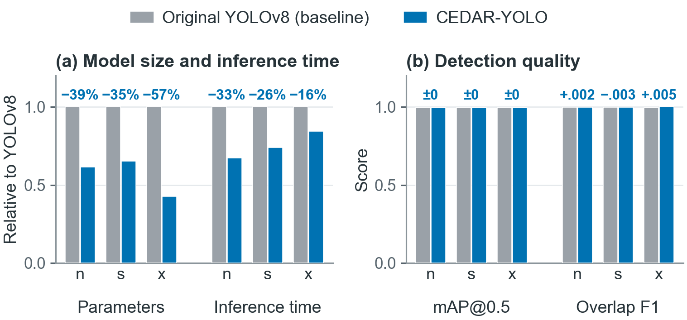
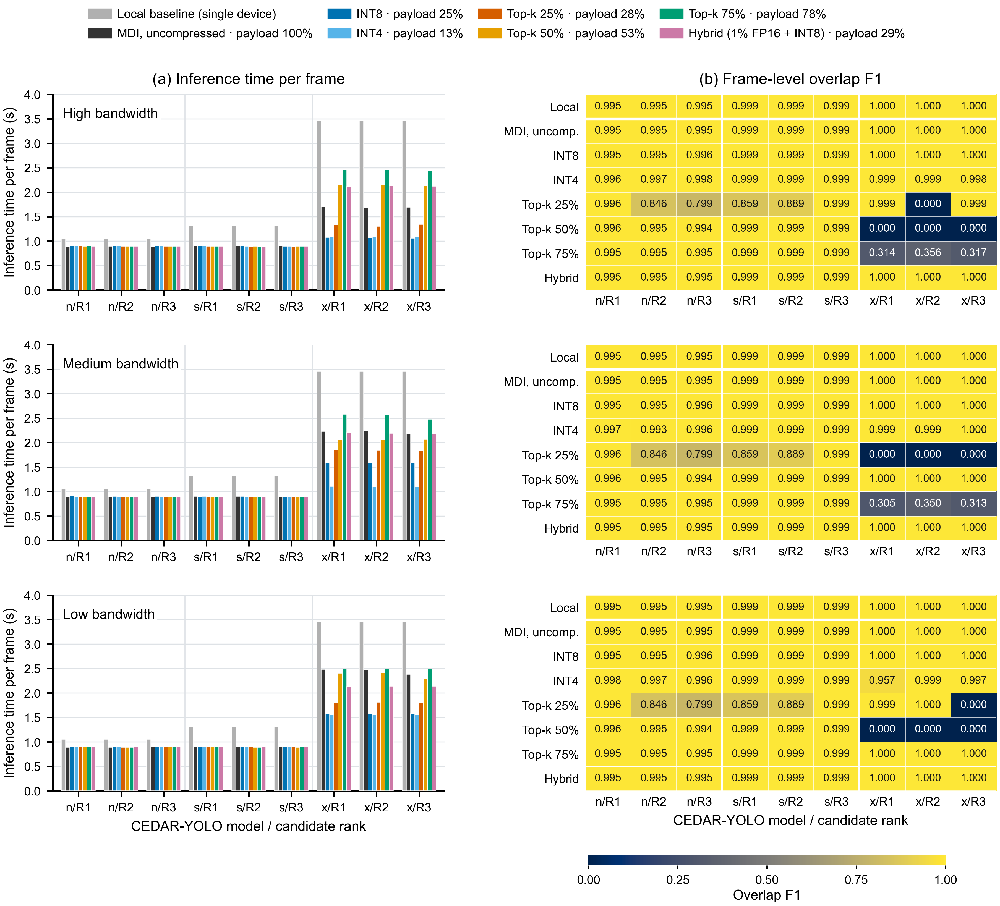

# CBRS-CEDAR-MDI

**The open-source implementation and experiment artifacts for the paper**
**"CEDAR-MDI: CBRS-Oriented Edge-Distributed Architecture for Radar Detection with Model-Distributed Inference"**
Teng Li and Hulya Seferoglu, University of Illinois Chicago (manuscript under submission).

We detect radar and LTE signals as objects in spectrograms and accelerate the
complete sensing pipeline on a physical NVIDIA Jetson Orin Nano testbed.

- **CBRS detection pipeline:** raw I/Q preprocessing, spectrogram generation, YOLO
  training and inference, and a frame-level frequency-overlap decision.
- **CEDAR-YOLO:** RF-aware structured pruning removes the multi-scale fusion neck
  and redundant detection scales. Independently configurable frequency/time grids
  and single-tensor block boundaries reduce computation and simplify partitioning.
- **CEDAR-MDI:** activation compression and offline partition/node-assignment
  optimization balance computation and communication to increase throughput.

## Results at a glance

These results follow the current manuscript's Table I and Figures 1-9.
Training and the CEDAR-YOLO quality sweep run on the **PC GPU**. Local timing and
all MDI experiments run on **Jetson CPUs in FP32**. Local/MDI comparisons use
matching checkpoints; the architecture-quality sweep uses the later PC edition.

**[Full experiment report: paper figures, tables, metrics and source data](results/REPORT.md).**
The recorded results can be viewed without downloading datasets or weights.

| Experiment | Main result | Reproduction guide |
|---|---|---|
| Original YOLO | All nine detectors achieve overlap F1 above 0.99 | [YOLO training and inference](docs/1_yolo.md) |
| Original-YOLO MDI | INT8 exceeds local throughput, but multi-tensor boundaries and uneven compute load limit scaling | [Original-YOLO MDI](docs/3_yolo_mdi.md) |
| CEDAR-YOLO | 35-57% fewer parameters and 16-33% less model inference time, with matching mAP@0.5 to reported precision and overlap F1 differences below 0.006 | [CEDAR-YOLO](docs/2_cedar_yolo.md) |
| CEDAR-MDI | Up to **3.27× local throughput**, with unchanged overlap F1 at the best configuration | [CEDAR-MDI](docs/4_cedar_mdi.md) |

### Original YOLO: communication and load imbalance


The top panels show the module-boundary partition and overlap F1. The bottom
panels compare **inference time per frame (1 / throughput)** under high, medium
and low bandwidth; gray bars are single-device local execution. INT8 improves
throughput over uncompressed MDI by up to 59%, 177% and 264%, respectively, with
an overlap-F1 change of at most 0.005. Every detector exceeds local throughput
with INT8. Compression reduces transfers, but the fixed backbone/neck/head
partition still leaves multiple tensors at each inner boundary and an overloaded
backbone node.

### CEDAR-YOLO: a smaller single-scale detector



At a 20 × 20 grid and full regression coverage, CEDAR-YOLO reduces parameter
counts by **39%, 35% and 57%**, and model inference time by **33%, 26% and 16%**
for nano, small and extra-large, respectively. The left panel normalizes size and
time to YOLOv8; the right compares mAP@0.5 and overlap F1. Timing uses the earlier
Jetson checkpoint edition; quality uses the later PC sweep edition. The full
[feature-grid and coverage sweep](results/REPORT.md#feature-grid-and-regression-coverage-sweep)
explains the selected configuration.

### CEDAR-MDI: partition flexibility and higher throughput



Rows show the three bandwidth environments. Left: inference time per frame;
right: overlap F1. Gray bars denote local execution. R1-R3 are the three
highest-ranked policies **for each model, environment and compressor**, so they
can represent different stage assignments. Legend payload percentages are the
pooled median compressed/uncompressed size ratios used by the offline optimizer.

The single-scale chain provides **165 feasible partitions** per model and
bandwidth environment. Compared with module-boundary MDI of original YOLOv8,
the paper reports up to **80% less transferred data**. Flexible cuts also balance
work across nodes. At the extra-large scale, CEDAR-MDI reaches **0.95 frames/s**,
compared with at most **0.53 frames/s** for original-YOLO module-boundary MDI.

The best speed-up is **3.27×** with extra-large CEDAR-YOLO, INT8, high bandwidth
and candidate R3, while overlap F1 remains **1.000**. The aggregate comparison
retains policies within 0.01 overlap F1 of local execution, excluding severe
quality degradation; all configurations remain visible in the figure.

**Throughput and single-frame delay are different metrics.** The plotted time is
total run time divided by completed frames, including pipeline fill and drain.
Pipelining raises throughput while increasing an individual frame's end-to-end
delay. The maximum observed delay is **7.1 s** in the best-speed-up configuration
and **16.1 s** across the quality-retained configurations. See the
[full report](results/REPORT.md#4-cedar-mdi) for latency, payload and load-balance results.

## Experiment environments

| Experiment | Platform and environment | Work performed |
|---|---|---|
| Model training and CEDAR-YOLO quality evaluation | Windows PC, Conda `torch270_py312_cuda`, CUDA GPU | Train original YOLO and CEDAR-YOLO; evaluate CEDAR feature-grid/coverage configurations on PNGs |
| Local speed baseline | One Jetson Orin Nano, L4T r36.4.0, Python 3.12 in `/opt/venv`, CPU FP32 | Measure the raw-I/Q pipeline and individual stages on one device |
| Model-distributed inference | Multiple Jetson Orin Nano devices, same Jetson environment, CPU FP32 | Run original-YOLO MDI and CEDAR-MDI over Wi-Fi, including compression and partition-policy comparisons |

The PC environment name is historical: its installed PyTorch version is **2.7.1**.
These are recommended, tested environments, not a requirement to match every
general-purpose library version. **Raw-I/Q preprocessing is the exception: preserve
the renderer's library versions and parameters, and check pixels against the supplied PNGs.**

| Component | PC: training / CEDAR quality | Jetson: local baseline / MDI |
|---|---|---|
| Python | 3.12.13, Conda `torch270_py312_cuda` | 3.12, `/opt/venv` |
| PyTorch / torchvision | 2.7.1+cu128 / 0.22.1+cu128 | 2.7.0 / 0.22.0, Jetson-compatible builds |
| Ultralytics | 8.4.46 | 8.4.46, CBRS detector dependency |
| NumPy / SciPy | 2.2.4 / 1.14.1 | 2.2.4 / 1.17.1 |
| Matplotlib / Pillow | 3.10.8 / 11.2.1 | 3.10.8 / 11.2.1 |
| Flask / Werkzeug | 3.0.3 / 3.0.4; only needed for local transport checks | 3.1.3 / 3.1.6 |
| requests / tqdm | 2.32.3 / 4.66.5 | 2.32.3 / 4.67.1 |

The [Jetson guide](docs/3_yolo_mdi.md#environment-on-every-node) links the shared
CAMDI environment and gives the multi-device setup. PC functional MDI checks do
not provide the paper's Jetson timing results. The CEDAR quality sweep and Jetson
timing also use different checkpoint editions; see [weights](docs/weights.md).

## Quick start: use our PNGs and pretrained models

**[Download CBRS-CEDAR-MDI-ASSETS v1.0 from GitHub Releases](https://github.com/UIC-Networking-Research-Lab/CBRS-CEDAR-MDI/releases/tag/assets)**

1. Open the release's **Assets** list and download **all 9 archive parts**:
   `CBRS-CEDAR-MDI-ASSETS.7z.001` through `CBRS-CEDAR-MDI-ASSETS.7z.009`.
   Keep all parts in the same folder with their original names.
2. Use **7-Zip** to extract `CBRS-CEDAR-MDI-ASSETS.7z.001` only. It reads the remaining
   parts automatically; do not extract each part separately.
3. Place the extracted `CBRS-CEDAR-MDI-ASSETS` folder beside the repository:

```text
workspace/
  CBRS-CEDAR-MDI/
  CBRS-CEDAR-MDI-ASSETS/
    datasets/
    weights/
    splits.csv
    README.md
```

Alternatively, extract from the folder containing all parts with:

```bash
7z x CBRS-CEDAR-MDI-ASSETS.7z.001
```

GitHub's **Source code (zip/tar.gz)** downloads contain code, not the datasets or
weights. Use this project's asset package; the MDI and RT packages are independent.

From the repository root, prepare the environment and install the assets:

On the PC, activate `torch270_py312_cuda` if it is already available. For a new
environment, use Python 3.12 and install platform-compatible PyTorch first.
`requirements.txt` supplies the remaining dependencies and selects the PC or
aarch64 Jetson SciPy rendering version.

```bash
pip install -r requirements.txt
python reproduce.py --assets ../CBRS-CEDAR-MDI-ASSETS --task install
python reproduce.py --task check --weights jetson
python reproduce.py --task png --weights jetson
```

The **CBRS-CEDAR-MDI-ASSETS** download contains `datasets/`, `weights/`, `splits.csv`
and a README. It includes all 640 × 640 PNGs, labels, fixed split membership and pretrained
weights, and is independent of the RT project's download. See the
[download guide](docs/download_bundle.md), [data](docs/data.md) and
[weights](docs/weights.md) for the layout. PNG evaluation requires no raw I/Q download.
The bundle also includes all **108 PC CEDAR quality/sweep checkpoints** from
`trained_models_cedar_best`. After installation, use `--weights latest --device 0`
for their PC evaluation. Never substitute one edition while comparing against another's results.

To evaluate only selected models:

```bash
python reproduce.py --task png --weights jetson --models cbrs_yolo8n sig_yolo_v8n_f20t20_c100
```

To predict a single image without running a benchmark:

```bash
python scripts/predict.py --weights trained_models/cbrs_yolo8n/weights/best.pt --image /path/to/sample.png
python scripts/predict.py --weights trained_models_mdi/sig_yolo_v8n_f20t20_c100/weights/best.pt --image /path/to/sample.png
```

## Preprocessing compatibility

**Parameters and library versions both matter.** Changing the FFT/window, overlap,
intensity scaling, clipping, colormap, orientation, image size, or rendering libraries
changes the spectrogram and can make the pretrained models unreliable.
**Use the supplied PNGs for reproduction; retrain your own model when using a different
preprocessing pipeline.** Keep training, calibration and deployment preprocessing identical.

Even a small rendering mismatch can invalidate pretrained-model predictions.
The checked PC renderer uses SciPy 1.14.1; Jetson uses 1.17.1. Both use NumPy
2.2.4, Matplotlib 3.10.8 and Pillow 11.2.1. Using the supplied PNGs avoids raw-I/Q
conversion; do not regenerate them with unverified settings.
[Preprocessing settings and pixel compatibility check](docs/preprocessing.md).

## Reproduce the paper pipelines

Run from the repository root. Add `--dry-run` to inspect a command without starting it.
New training writes `trained_models_retrained/`, keeping released weights intact.

| Task | Command |
|---|---|
| Train original YOLO | `python reproduce.py --task train-yolo` |
| Train CEDAR-YOLO | `python reproduce.py --task train-cedar` |
| Evaluate supplied PNGs | `python reproduce.py --task png --weights jetson` |
| Rebuild offline partition rankings | `python reproduce.py --task offline` |
| Original YOLO raw-I/Q local baseline | `python reproduce.py --task local-yolo` |
| CEDAR raw-I/Q local baseline | `python reproduce.py --task local-cedar --weights jetson` |

Raw-I/Q timing and MDI need the original recordings. Download the
[Genesys Lab over-the-air CBRS dataset](https://genesys-lab.org/CBRS), then restore the
**provided** train/validation/test split rather than choosing a new random split:

```bash
python reproduce.py --task raw-split --raw-source /path/to/IEEE_UPLOAD
python scripts/check_rendering.py --raw-source /path/to/IEEE_UPLOAD
```

For four-device MDI, follow the [Jetson setup and launch steps](docs/3_yolo_mdi.md#1-prepare-the-jetson-testbed).
Install the environment and weights on each node. Place the PNG
labels and raw test split on A. Start B, C and D before A, changing `--node` on each host:

```bash
python reproduce.py --task cedar-mdi --node B --hosts 192.168.1.20 192.168.1.21 192.168.1.22 192.168.1.23
```

Use `--task yolo-mdi` for the original-YOLO compression sweep. The framework selects
its saved offline-ranked partitions for CEDAR; [Part 4](docs/4_cedar_mdi.md) explains
profiling and reranking on your own hardware. A one-computer functional check is:

```bash
python reproduce.py --task cedar-mdi --local-nodes --models sig_yolo_v8n_f20t20_c100 --max-samples 2
```

This checks the four processes and tensor transfers; only runs on separate Jetsons
with the configured links reproduce the testbed timing conditions.

## Files and reference hardware

`cbrs/`: model, preprocessing, compressors and transport. `scripts/`: the four pipelines,
asset installer and checks. `configs/`: paper partitions and measured profiles.
`splits/cbrs_split.csv`: immutable split. `results/paper/`: numerical paper results.
`results/training_logs/`: released original-YOLO training logs.

The testbed has four Jetson Orin Nano 8 GB devices connected through 802.11ac Wi-Fi,
CPU FP32 execution, and high/medium/low bandwidth environments configured by token buckets.
The environment matches [CAMDI's Jetson testbed](https://github.com/UIC-Networking-Research-Lab/CAMDI_RC_MobiHoc2026_Fitting_and_Jetson):
L4T r36.4.0, Python 3.12, PyTorch 2.7.0 and torchvision 0.22.0.
The [Jetson guide](docs/3_yolo_mdi.md) covers library versions, asset installation,
raw-data restoration, networking, launch order, local baselines and result files.

## Citation and related work

```bibtex
@misc{li2026cedarmdi,
  title = {CEDAR-MDI: CBRS-Oriented Edge-Distributed Architecture for Radar Detection with Model-Distributed Inference},
  author = {Li, Teng and Seferoglu, Hulya},
  year = {2026},
  note = {Manuscript under submission}
}
```

Please also cite Tassie et al., *Detection of Co-existing RF Signals in CBRS Using ML:
Dataset and API-Based Collection Testbed*, IEEE Communications Magazine, 2023, when
using the dataset. Its original download, description and citation are on the
[dataset page](https://genesys-lab.org/CBRS).

[**CBRS-CEDAR-RT**](https://github.com/UIC-Networking-Research-Lab/CBRS-CEDAR-RT)
is a derivative project exploring GPU deployment of these pretrained detectors with
ONNX Runtime and TensorRT. Its GPU results are separate from this paper's CPU/MDI results.

## License

[GNU AGPL-3.0](LICENSE). Ultralytics also uses AGPL-3.0.
The original dataset and pretrained initialization weights retain their own terms.
