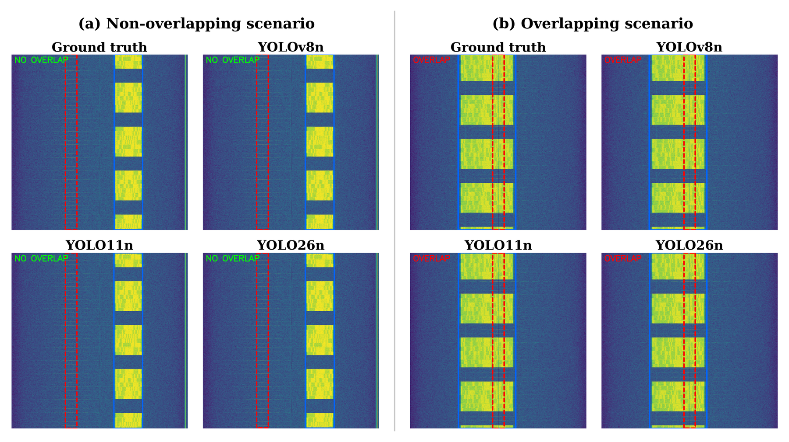
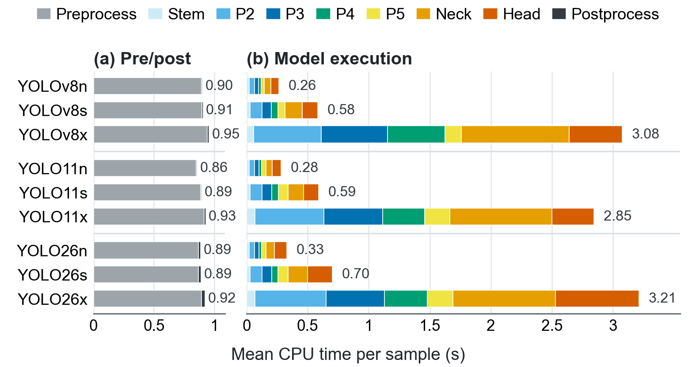

# Part 1 – Original YOLO: training and inference

This part trains and evaluates the unmodified Ultralytics detectors: YOLOv8, YOLO11 and
YOLO26 at the n/s/x scales (9 models), plus RT-DETR-L as a transformer reference. It also
measures the end-to-end pipeline from raw I/Q to the overlap decision, stage by stage.

Prerequisites: `yolo_split/` ([data.md](data.md)); `raw_sigmf_split/` is needed only for raw-I/Q timing and MDI, and
the released weights in `trained_models/` ([weights.md](weights.md)) if you skip training.

<p align="center"></p>

## 1. Training

Train on the **PC GPU**, using the tested Conda environment `torch270_py312_cuda`.
The [environment table](../README.md#experiment-environments) records its versions.
Jetson is used for the local speed baseline and MDI, not for training.

```bash
python scripts/yolo/train_yolo.py      # 9 YOLO models
python scripts/yolo/train_rtdetr.py    # RT-DETR-L
```

Both scripts read `yolo_split/data.yaml` and write each run to `trained_models_retrained/<run>/`
(`weights/best.pt`, `results.csv`, `args.yaml`, curves). The COCO-pretrained
starting weights (`yolov8n.pt`, ...) are downloaded by Ultralytics on first use.

Configure the scripts through the globals at the top of each file:

| Global | Default | Meaning |
|---|---|---|
| `RUN_MODE` | `"sweep"` | `"sweep"` trains every version × scale in `SWEEP_VERSIONS` × `SWEEP_SCALES`; `"train"` trains `MODEL_NAME` as `RUN_NAME` |
| `EPOCHS`, `BATCH_SIZE`, `IMG_SIZE` | 25, 16, 640 | values used for the released checkpoints |
| `DEVICE` | `None` | Ultralytics auto; `"0"` = GPU 0, `"cpu"` = CPU |
| `SWEEP_PARALLEL` | 1 | number of models trained at the same time |

The remaining hyper-parameters are Ultralytics defaults: the `auto` optimizer (which
resolves to AdamW, lr 1.667e-3), 3 warm-up epochs, a linear LR schedule, mosaic (off for
the last 10 epochs), HSV / translate / scale / flip augmentation, seed 0,
deterministic mode and AMP. The exact settings of each released model are in
`results/training_logs/<run>/args.yaml`.

## 2. Inference on spectrogram PNGs

Evaluates box mAP and the frame-level overlap decision on `yolo_split/test`:

```bash
# every model under trained_models/ (CEDAR-YOLO runs are skipped)
python scripts/yolo/test_yolo.py

# one model, metrics only
python scripts/yolo/test_yolo.py --models trained_models/cbrs_yolo8n --no-predict

# one image
python scripts/yolo/test_yolo.py --models trained_models/cbrs_yolo8n --image path/to/spectrogram.png
```

Output is written to `yolo_results/<run>/`: Ultralytics validation plots,
`analysis/evaluation_summary.json` (mAP, overlap confusion matrix, precision/recall/F1),
and annotated predictions in `predictions/`. A table over all models goes to `yolo_results/summary/`.

Inference uses confidence 0.25 and NMS IoU 0.45. A frame counts as *overlapping* when
the frequency intervals of any LTE box and any radar box intersect.

## 3. End-to-end inference from raw I/Q (paper protocol)

Run this timing experiment on **one Jetson Orin Nano CPU in FP32**, in the same
`/opt/venv` environment used by MDI. See the [Jetson setup](3_yolo_mdi.md#environment-on-every-node).
PC PNG inference is a separate workload and does not reproduce the Jetson baseline speed.

`local_sigmf_baseline.py` runs the full pipeline on one device, one frame at a time:
raw SigMF → spectrogram tensor → model → post-processing → metrics.

```bash
# one model on CPU, full test split (848 frames)
python scripts/yolo/local_sigmf_baseline.py --no-sweep --model_name cbrs_yolo8n --device cpu

# all 10 models, CPU only
python scripts/yolo/local_sigmf_baseline.py --sweep --sweep_devices cpu

# quick check on the first 20 frames
python scripts/yolo/local_sigmf_baseline.py --no-sweep --model_name cbrs_yolo26n --device cpu --max_samples 20
```

Outputs (`local_baseline_results/`): a per-frame CSV with `read_convert_sec`, `inference_sec`,
`postprocess_sec` and `end_to_end_sec`; `_quality.json` with mAP and overlap metrics;
and a summary plot. Sweep mode also writes `sweep_summary.csv`.

For the per-stage breakdown in the paper (preprocessing steps, stem, P2–P5, neck, head,
and the tensor size at each module boundary), use:

```bash
python scripts/yolo/local_sigmf_stage_cost_test.py --sweep --sweep_devices cpu
python scripts/plots/plot_local_stage_cost.py --input_dir local_baseline_results_by_stage_cost
```

Both scripts read frames from `raw_sigmf_split/<split>/` and labels from `yolo_split/`.
Useful options: `--split`, `--max_samples`, `--conf_threshold`, `--iou_threshold`,
`--run_location` (a tag added to output names) and `--output_dir`.

## 4. Reference results

Local inference on one Jetson Orin Nano CPU (FP32), with the full 848-frame test split
starting from raw I/Q (paper Table I).
Delay is the mean per-frame time from raw SigMF to detections. Prec., Rec. and F1 refer
to the frame-level overlap decision.

| Model | Delay (s) | Thr. (frames/s) | Prec. | Rec. | F1 | mAP@0.5 |
|---|---:|---:|---:|---:|---:|---:|
| YOLOv8n | 1.181 | 0.846 | 1.000 | 0.995 | 0.997 | 0.995 |
| YOLOv8s | 1.489 | 0.671 | 1.000 | 0.998 | 0.999 | 0.995 |
| YOLOv8x | 4.123 | 0.243 | 1.000 | 0.989 | 0.995 | 0.995 |
| YOLO11n | 1.142 | 0.875 | 1.000 | 0.995 | 0.997 | 0.995 |
| YOLO11s | 1.452 | 0.688 | 1.000 | 1.000 | 1.000 | 0.995 |
| YOLO11x | 3.839 | 0.260 | 1.000 | 0.989 | 0.995 | 0.995 |
| YOLO26n | 1.226 | 0.815 | 1.000 | 0.996 | 0.998 | 0.994 |
| YOLO26s | 1.593 | 0.628 | 1.000 | 0.989 | 0.995 | 0.995 |
| YOLO26x | 4.168 | 0.240 | 1.000 | 0.982 | 0.991 | 0.991 |

All detectors reach high detection and overlap quality. Larger models add execution
cost without improving quality.

<p align="center"></p>

Data: [`results/paper/yolo_cpu_detector_results.csv`](../results/paper/yolo_cpu_detector_results.csv),
[`results/paper/yolo_cpu_stage_cost_data.csv`](../results/paper/yolo_cpu_stage_cost_data.csv).

YOLO26 uses its NMS-free one-to-one head at inference. The scripts select this
post-processing automatically for `cbrs_yolo26*` models.

On a desktop GPU the PNG-based `test_yolo.py` gives the same quality. For example,
`cbrs_yolo8n` on the 848 test PNGs has mAP@0.5 0.995 and overlap F1 0.997 (555 TP, 3 FN, 0 FP, 290 TN).
