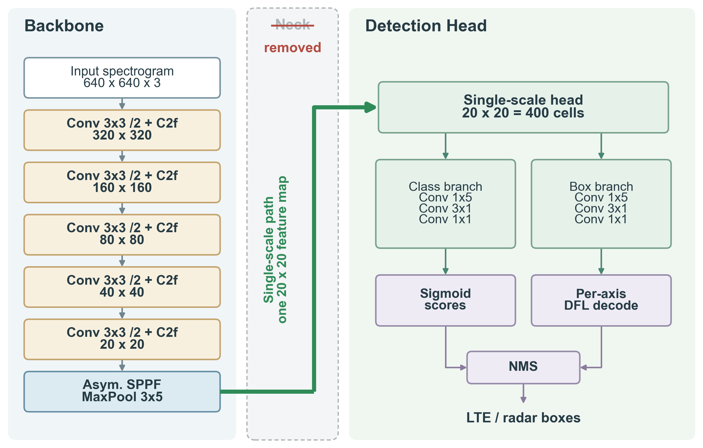
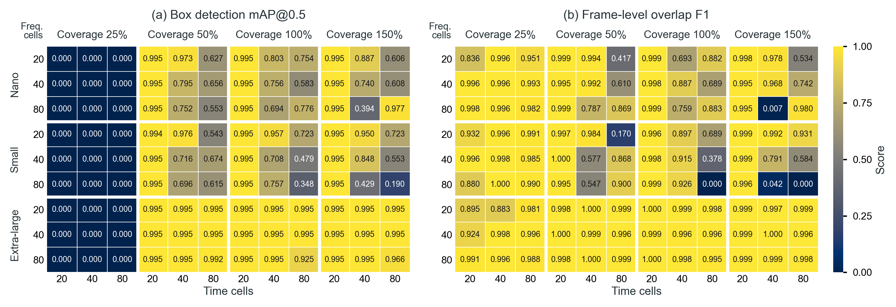

# Part 2 – CEDAR-YOLO: training and inference

CEDAR-YOLO removes the multi-scale neck of YOLO. A YOLOv8-style backbone feeds an
asymmetric SPPF (3×5 time×frequency pooling) and a single detection head with factorized
1×5 frequency and 3×1 time convolutions. The numbers of frequency and time cells of the
output grid are set independently, and each backbone stage downsamples one or both
axes. Box regression uses separate distribution bins for the frequency sides
(left/right) and the time sides (top/bottom).

<p align="center"></p>

In the code, CEDAR-YOLO is called *SigYOLO* / *AsymYOLO*. The model is defined in
[`cbrs/cedar_yolo.py`](../cbrs/cedar_yolo.py). Runs are named

```
sig_yolo_<variant><size>_f<frequency cells>t<time cells>_c<coverage %>
e.g. sig_yolo_v8n_f20t20_c100  = v8 backbone, nano, 20x20 grid, 100 % regression coverage
```

*Coverage* sets the number of distribution bins per box side relative to the grid size.
With 20 cells, 25/50/100/150 % give 5/10/20/30 bins. The scripts read the architecture
from the run name, so keep it unchanged.

Prerequisites: `yolo_split/` ([data.md](data.md)); raw-I/Q timing additionally needs `raw_sigmf_split/`, and
the released weights in `trained_models/` ([weights.md](weights.md)) if you skip training.

## 1. Training

Training runs on the **PC GPU** in Conda `torch270_py312_cuda`, not on Jetson.
See the [PC/Jetson environment table](../README.md#experiment-environments).

```bash
python scripts/cedar/train_cedar_yolo.py
```

By default the script trains the three paper models `sig_yolo_v8{n,s,x}_f20t20_c100`
from random initialization and writes them to `trained_models_retrained/<run>/weights/{best,last}.pt`.
It uses our own PyTorch training loop, not Ultralytics. Edit the globals at the top of the file:

| Global | Default | Meaning |
|---|---|---|
| `RUN_MODE` | `"sweep"` | `"sweep"` trains every combination below; `"train"` trains one model from `VARIANT`, `SIZE`, `FM_FREQ`, `FM_TIME`, `REG_MAX_FREQ`, `REG_MAX_TIME` |
| `SWEEP_VARIANTS` / `SWEEP_SCALES` | `["v8"]` / `["n","s","x"]` | backbone family and scale (`v11`, `v26` variants are also implemented) |
| `SWEEP_FM_FREQS` / `SWEEP_FM_TIMES` | `[20]` / `[20]` | grid cells per axis; 640 / cells must be a power of two |
| `SWEEP_COVERAGE_LEVELS` | `[1.00]` | regression coverage |
| `EPOCHS`, `BATCH_SIZE`, `PATIENCE` | 100, 8, 20 | epoch budget, batch size, early-stopping patience on val mAP@0.5 |
| `SKIP_COMPLETED` | `True` | skip explicitly completed or early-stopped runs; resume interrupted new-format checkpoints |

To run the full 108-configuration sweep from the paper, set
`SWEEP_FM_FREQS = SWEEP_FM_TIMES = [20, 40, 80]` and
`SWEEP_COVERAGE_LEVELS = [0.25, 0.50, 1.00, 1.50]`.

Equal mAP values do not reset patience. New checkpoints store optimizer, scheduler,
EMA, scaler, early-stop and random-number state for resume. Legacy checkpoints without
that state are never treated as complete merely because they reached 25 epochs; retrain
them in a new output directory. Training defaults write to `trained_models_retrained/`.
These updates do not change any released checkpoint or recorded result.

Training details: SGD with Nesterov momentum (lr 0.01, momentum 0.937, weight decay 5e-4), 3 warm-up epochs,
a cosine schedule to 1 % of the initial LR, and loss weights of 7.5 (box IoU), 0.5 (BCE classification) and
1.5 (DFL). An exponential moving average of the weights is kept, and the checkpoint with
the best validation mAP@0.5 is saved as `best.pt`. Augmentation is off (`USE_AUGMENT = False`).

## 2. Inference on spectrogram PNGs

The paper's CEDAR-YOLO quality/architecture sweep runs on the **PC GPU**, in the
same Conda environment as training. It uses the later local/sweep checkpoints.

```bash
# every sig_yolo_* checkpoint under trained_models/, on GPU 0
python scripts/cedar/test_cedar_yolo.py --models_dir trained_models --device 0

# metrics only
python scripts/cedar/test_cedar_yolo.py --no_viz --no_sweep_plots
```

Output (`asym_yolo_results/`): `results.json` and `summary.csv` with mAP@0.5,
mAP@0.5:0.95, per-class AP, the overlap confusion matrix and F1, the checkpoint epoch and
the parameter count. It also writes annotated predictions (`<run>/predictions/`) and,
for sweeps, heat maps over the grid and coverage settings (`sweep_plots/`).
Options: `--split`, `--conf` (0.25), `--iou` (0.45), `--batch`, `--data`.

## 3. End-to-end inference from raw I/Q (paper protocol)

The paper's **local speed baseline runs on one Jetson Orin Nano CPU in FP32**,
using the Jetson `/opt/venv` environment and earlier Jetson checkpoint edition.
This is separate from the PC quality sweep above. Use the
[same Jetson setup as MDI](3_yolo_mdi.md#environment-on-every-node).

```bash
# the three paper models, CPU, full test split
python scripts/cedar/local_cedar_stage_cost_test.py --sweep --sweep_devices cpu --models_dir trained_models_mdi

# one model
python scripts/cedar/local_cedar_stage_cost_test.py --no-sweep --model_name sig_yolo_v8n_f20t20_c100 --device cpu --models_dir trained_models_mdi

# the local baseline of the CEDAR-MDI experiments (part 4) uses the MDI checkpoints
python scripts/cedar/local_cedar_stage_cost_test.py --sweep --sweep_devices cpu --models_dir trained_models_mdi
```

This runs the same pipeline as part 1: raw SigMF → spectrogram tensor → backbone → SPPF →
head (box, class, decode) → NMS → metrics. Every stage is timed. Output goes to
`local_baseline_results_by_stage_cost_asym_yolo/` in the same CSV / JSON / PNG format as part 1.

## 4. Reference results

### Parameter sweep

<p align="center"></p>

The sweep covers 108 configurations on the test set: 3 scales × 3 frequency grids
× 3 time grids × 4 coverage levels. At 25 % coverage the distribution bins cannot
span the boxes, so mAP@0.5 is 0. From 50 % coverage onward, the x model reaches
mAP@0.5 ≥ 0.925 on every grid. The 20×20 grid performs best or ties for best, so it is
used for all other experiments.
Data: [`results/paper/cedar_yolo_sweep_data.csv`](../results/paper/cedar_yolo_sweep_data.csv).

### CEDAR-YOLO vs. YOLOv8 (20×20 grid, 100 % coverage)

| Scale | Parameters (M) YOLOv8 → CEDAR | Model time (s) YOLOv8 → CEDAR | mAP@0.5 YOLOv8 → CEDAR | Overlap F1 YOLOv8 → CEDAR |
|---|---|---|---|---|
| n | 3.01 → 1.85 (−39 %) | 0.264 → 0.178 (−33 %) | 0.995 → 0.995 | 0.997 → 0.999 |
| s | 11.14 → 7.27 (−35 %) | 0.582 → 0.431 (−26 %) | 0.995 → 0.995 | 0.999 → 0.996 |
| x | 68.15 → 29.17 (−57 %) | 3.076 → 2.593 (−16 %) | 0.995 → 0.995 | 0.995 → 1.000 |

*Model time* is the model-execution portion of the raw-I/Q pipeline on one Jetson Orin Nano CPU in FP32.
These timing measurements run on Jetson with the earlier checkpoints; the PNG quality columns run on the PC with the later sweep checkpoints. They are separate measurements, not a joint speed/quality evaluation of one checkpoint.
Quality is measured on the 848 test frames with the sweep checkpoints in `trained_models/`.

<p align="center"></p>

Data: [`results/paper/cedar_yolo_local_comparison_data.csv`](../results/paper/cedar_yolo_local_comparison_data.csv).

With the earlier checkpoints in `trained_models_mdi/`, `test_cedar_yolo.py` gives
mAP@0.5 / overlap F1 of 0.895 / 0.995 (n), 0.995 / 0.999 (s) and 0.995 / 1.000 (x).
