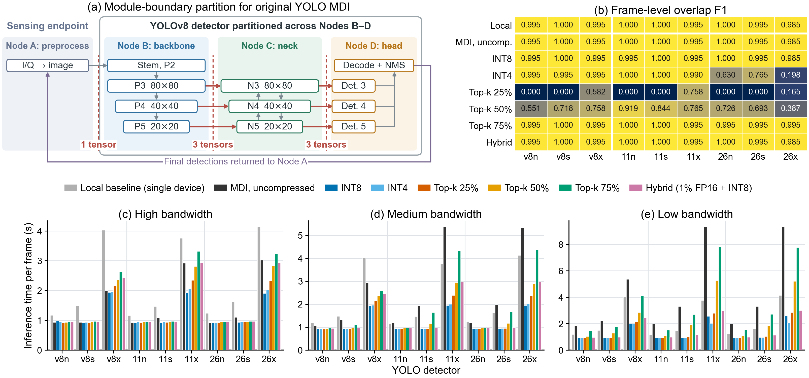

# Part 3 – Model-distributed inference (MDI) of the original YOLO detectors

This part splits the raw-I/Q pipeline of an original YOLO detector over four nodes
and streams the test frames through them over HTTP:

```
A: SigMF preprocessing  ->  B: backbone  ->  C: neck  ->  D: head + NMS  ->  results back to A
```

The cuts follow the module boundaries in
[`configs/module_boundary_partitions.json`](../configs/module_boundary_partitions.json).
For RT-DETR, C runs the encoder and D the decoder. At each cut, every feature map that
crosses the boundary is sent (several tensors for the multi-scale neck). Optionally, every
forward transfer, including the A→B image tensor, is compressed.

<p align="center"></p>

Install the repository and its asset package on every node as described below.
Only node A needs the separately downloaded raw test recordings.

## Scripts

| Script | Use |
|---|---|
| `scripts/mdi/yolo_mdi.py` | uncompressed MDI (paper: uncompressed runs on the full test split) |
| `scripts/mdi/yolo_mdi_compressed.py` | MDI with activation compression (paper: compression sweep on the first 100 test frames) |
| `scripts/mdi/run_local_4node.py` | runs all four nodes on one machine as a functional test |
| `scripts/plots/plot_yolo_mdi_vs_local.py` | compares MDI runs with the local baseline from part 1 |

## 1. Prepare the Jetson testbed

The paper uses four NVIDIA Jetson Orin Nano nodes connected through an 802.11ac access
point, with CPU execution in FP32. Each node runs an HTTP service. By default the nodes
use `192.168.1.20`–`.23` and ports `52000`–`52003` for A–D; override them with
`--ip_a ... --ip_d` and `--port_a ... --port_d`.

Different token-bucket parameters produce the high, medium and low bandwidth
environments. Their measured mean rates were approximately 70, 38 and 21 Mbps;
rates vary slightly across runs. The numbers passed to `--sweep_rates_mbps` below
are token-bucket settings, not measured Wi-Fi link capacities.

### Environment on every node

This environment applies to **both the single-Jetson local speed baseline and
multi-Jetson MDI**. Model training and the CEDAR-YOLO quality sweep instead use
the PC Conda environment `torch270_py312_cuda` ([comparison](../README.md#experiment-environments)).

This testbed uses the same environment as
[CAMDI_RC_MobiHoc2026_Fitting_and_Jetson](https://github.com/UIC-Networking-Research-Lab/CAMDI_RC_MobiHoc2026_Fitting_and_Jetson).
Its [requirements](https://github.com/UIC-Networking-Research-Lab/CAMDI_RC_MobiHoc2026_Fitting_and_Jetson/blob/main/requirements.txt)
record these versions:

| Component | Jetson reference |
|---|---|
| System | NVIDIA L4T r36.4.0, aarch64 |
| Python | 3.12, virtual environment `/opt/venv` |
| PyTorch / torchvision | 2.7.0 / 0.22.0, Jetson-compatible builds |
| NumPy / SciPy | 2.2.4 / 1.17.1 |
| Matplotlib / Pillow | 3.10.8 / 11.2.1 |
| Flask / Werkzeug | 3.1.3 / 3.1.6 |
| requests / tqdm | 2.32.3 / 4.67.1 |

CBRS additionally uses Ultralytics 8.4.46 and the CEDAR implementation included here.
The table records the tested/recommended versions; compatible versions of general
inference and HTTP libraries can also be used. Preserve the raw-I/Q preprocessing
versions and parameters and verify the generated pixels before using pretrained
models. The reference CAMDI environment also includes transformer/tokenization
and fitting packages for its own experiments; CBRS does not require those unused
packages simply to match the environment list.
Reuse the CAMDI Jetson environment if available. For a fresh device, prepare the
system, Python and matching NVIDIA/aarch64 PyTorch builds first; `requirements.txt`
installs the remaining CBRS dependencies without installing PyTorch. Desktop x86
CUDA wheels cannot be used on a Jetson.

Run on **each** device, from the repository root:

```bash
source /opt/venv/bin/activate
cat /etc/nv_tegra_release
python --version
python -c "import torch, torchvision; print(torch.__version__, torchvision.__version__)"
python -m pip install -r requirements.txt
python reproduce.py --assets ../CBRS-CEDAR-MDI-ASSETS --task install
python reproduce.py --task check
```

Use the supplied earlier Jetson CEDAR weights in `trained_models_mdi/` for both
CEDAR-MDI and its local baseline. The supplied PC quality/sweep weights are a separate
experiment edition and are not needed for these tests.

### Raw recordings on node A

Download the I/Q recordings from [Genesys Lab](https://genesys-lab.org/CBRS), then
restore the provided test membership. Do not create a new random split.

```bash
python scripts/data/restore_raw_split.py --source /path/to/IEEE_UPLOAD --splits test --output raw_sigmf_split
python scripts/check_rendering.py --raw-source /path/to/IEEE_UPLOAD
python scripts/check_release.py --weights jetson --raw
```

The rendering check samples the original download across train/validation/test
groups and compares pixels with the supplied PNGs. A preprocessing mismatch must
be resolved before using pretrained weights on raw I/Q. See
[preprocessing settings](preprocessing.md). PNG inference alone needs no I/Q files,
but does not reproduce the preprocessing cost of this experiment.

### Network and launch order

| Role | Default address | Listening port |
|---|---|---:|
| A, source and coordinator | 192.168.1.20 | 52000 |
| B | 192.168.1.21 | 52001 |
| C | 192.168.1.22 | 52002 |
| D | 192.168.1.23 | 52003 |

Put all devices on the same Wi-Fi network, allow peer connections on these TCP
ports, and disable access-point client isolation. If using containers, make the
services reachable on the listed host addresses, for example with host networking.
Set the `IPS` variable below separately in every terminal. Run each worker command
on its corresponding device, not all three on one Jetson.

Start B, C and D before A. From A, check the workers before launching a sweep:

```bash
curl --fail http://192.168.1.21:52001/health
curl --fail http://192.168.1.22:52002/health
curl --fail http://192.168.1.23:52003/health
```

Node A shuts down the workers when its sweep ends. **Restart B, C and D before
each subsequent A command**, including after a short functional check. If a run is
interrupted, stop any remaining workers before restarting. Use consistent power,
cooling and CPU settings for local baselines, profiles and distributed measurements.

## 2. Run on four devices

Start the workers B, C and D first, then node A. Node A sends the model, partition,
compressor and link-rate settings for each case to the workers, so the workers only
need their node role and the addresses.

```bash
IPS="--ip_a 192.168.1.20 --ip_b 192.168.1.21 --ip_c 192.168.1.22 --ip_d 192.168.1.23"

# on B, C and D
python scripts/mdi/yolo_mdi_compressed.py --node B $IPS --device cpu
python scripts/mdi/yolo_mdi_compressed.py --node C $IPS --device cpu
python scripts/mdi/yolo_mdi_compressed.py --node D $IPS --device cpu

# on A: paper YOLO compression comparison
YOLO_MODELS="cbrs_yolo8n,cbrs_yolo8s,cbrs_yolo8x,cbrs_yolo11n,cbrs_yolo11s,cbrs_yolo11x,cbrs_yolo26n,cbrs_yolo26s,cbrs_yolo26x"
python scripts/mdi/yolo_mdi_compressed.py --node A $IPS --device cpu \
    --sweep_models "$YOLO_MODELS" --compressor sweep --sweep_rates_mbps 150,50,25 \
    --max_samples 100 --output_dir experiment_reruns/yolo_mdi_compressed
```

Before the full sweep, use this A command with the same workers to check one
uncompressed model on two frames:

```bash
python scripts/mdi/yolo_mdi_compressed.py --node A $IPS --device cpu \
    --model_name cbrs_yolo8n --compressor none --sweep_rates_mbps 150 \
    --max_samples 2 --output_dir experiment_reruns/yolo_network_check
```

For the matching uncompressed comparison, restart the workers and repeat the
compression-sweep command with `--compressor none` and a separate output directory.
For the paper's full-test-split uncompressed experiment, use `yolo_mdi.py` on
**all four nodes**, omit `--compressor` and `--max_samples`, and retain the explicit
YOLO model list on A. The script also supports RT-DETR, which is not in the nine-YOLO
comparison.

Run the matching local baseline on one Jetson, with the same frames and CPU setting:

```bash
python scripts/yolo/local_sigmf_stage_cost_test.py --sweep --sweep_devices cpu \
    --sweep_models "$YOLO_MODELS" --max_samples 100 --run_location jetson \
    --output_dir experiment_reruns/yolo_local_100
```

Omit `--max_samples` for the full-test baseline. Keep the full-test and short-sweep
outputs separate when comparing quality and timing.

Useful options for node A:

| Option | Meaning |
|---|---|
| `--model_name cbrs_yolo8n` | run one model instead of `--sweep_models` (default: all 10) |
| `--compressor` | `sweep` (default: INT8, INT4, top-k 25/50/75 %, LLM.int8-style hybrid), `none`, `quantization`, `topk`, `llmint8` |
| `--compression_param` | setting for a single compressor, e.g. `int8`, `int4`, `0.5`, `"[0.01, 'fp16', 'int8']"` |
| `--sweep_rates_mbps` | comma-separated link rates in Mbps (default `150,50,25`) |
| `--max_samples` | first N test frames (default: the full test split) |
| `--max_inflight` | frames in flight in the pipeline (default 6) |
| `--output_dir` | default `distributed_stage_sweep_results/` |

Compressors (implemented in [`cbrs/compressors.py`](../cbrs/compressors.py)):
INT8/INT4 quantization; top-k sparsification that keeps 25/50/75 % of values by
magnitude; and a hybrid in the style of LLM.int8() that keeps values above the 99th
magnitude percentile in FP16 and quantizes the rest to INT8. The receiving node
reconstructs each tensor before it runs its module.

## 3. Functional test on one machine

```bash
python scripts/mdi/run_local_4node.py scripts/mdi/yolo_mdi_compressed.py \
    --model_name cbrs_yolo8n --compressor quantization --compression_param int8 \
    --sweep_rates_mbps 150 --max_samples 10 --run_location local --output_dir mdi_local_test
```

This starts B, C and D in the background on `127.0.0.1`, runs A, and stops the workers
when A finishes. The timings do not represent the Jetson testbed.

## 4. Outputs

For each model × compressor × rate case:

| File | Content |
|---|---|
| `distributedModule_FastSigmf_<model>_<location>_<device>_<compressor>_rate<R>mbps_samples<N>.csv` | per frame: node compute times, link times, payload bytes, detections and quality |
| `..._summary.csv` | one row per case: mean task delay, seconds per task, throughput, payload, mAP@0.5, overlap F1 |
| `..._quality.json` | configuration, partition and pooled quality metrics |

*Task delay* is the time from admitting a frame at A to receiving its result.
*Seconds per task* is the total run time divided by the number of frames, i.e. the
inverse throughput of the pipeline.

To plot MDI against the CPU local baseline from part 1:

```bash
python scripts/plots/plot_yolo_mdi_vs_local.py \
    --baseline_dir local_baseline_results \
    --fullsamples_no_compress_dir <uncompressed MDI output dir> \
    --compressed_100_dir <compressed MDI output dir> \
    --output_dir distributed_vs_baseline_plots
```

## 5. Reference results (paper Figure 5)


The timing bars show **inference time per frame = 1 / throughput**, including
pipeline filling and draining. Gray bars show the single-Jetson local baseline.
This metric differs from the mean end-to-end delay recorded in the output CSVs.
The top-left panel shows the module-boundary assignment; the top-right panel
reports overlap F1 at high bandwidth.

The local/compressed comparison uses the first 100 test frames. Uncompressed
F1 is recomputed for the corresponding subset of its full run, while its
throughput is taken from the full run, following the paper's protocol.

- Uncompressed MDI preserves local overlap F1 and mAP@0.5 on the full test set.
  Throughput is 1.25-2.07× local at high bandwidth, but only 0.41-0.77× at low bandwidth.
- INT8 reduces payload to about 25%, changes overlap F1 by at most 0.005 and
  exceeds local throughput for every detector. Its largest throughput gains over
  uncompressed MDI are 59%, 177% and 264% at high, medium and low bandwidth.
- Hybrid compression transmits about 30% of the payload and matches uncompressed
  F1. Top-k at 25% or 50% reduces F1; INT4 lowers YOLO26 F1 to 0.20-0.80.
  The small INT4 quality differences between bandwidth environments come from
  stochastic rounding. The original-YOLO partition itself is fixed.
- The structural bottlenecks remain: three feature tensors cross each inner
  model boundary, and the extra-large backbone carries 41-44% of computation.
  Compression reduces transfer cost but does not rebalance this fixed partition.

See the [full report](../results/REPORT.md#3-original-yolo-mdi) for payload,
throughput and end-to-end delay comparisons. In particular, a higher end-to-end
delay does not imply lower throughput in a pipelined execution.

Data: [full-test local/MDI comparison](../results/paper/yolo_mdi_vs_local_results.csv),
[compression sweep](../results/paper/yolo_mdi_bandwidth_comparison_data.csv),
[payload and delay summary](../results/paper/yolo_module_boundary_summary.csv).
