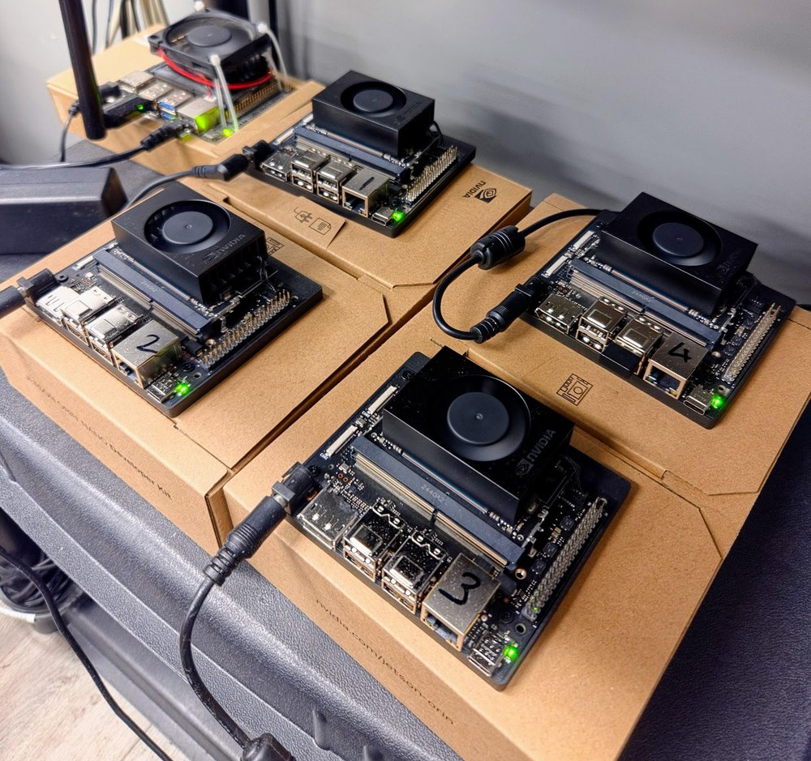

# Paper experiment report

Results accompanying **CEDAR-MDI: CBRS-Oriented Edge-Distributed Architecture for
Radar Detection with Model-Distributed Inference** (manuscript under submission).
Aligned with the current manuscript (`papers/paper/main.tex`, checked 2026-10-29).
All figures below are included in the repository and display without downloading
datasets or weights. Numerical records are in [`paper/`](paper/).

| Experiment | Finding | Details |
|---|---|---|
| Original YOLO | High radar/LTE detection quality on the Jetson platform | [1. Local detection](#1-original-yolo-local-detection) |
| CEDAR-YOLO | Fewer parameters and less model computation with a single-scale architecture | [2. Architecture evaluation](#2-cedar-yolo-architecture-evaluation) |
| Original-YOLO MDI | Compression improves throughput; multi-tensor boundaries and compute imbalance limit scaling | [3. Original-YOLO MDI](#3-original-yolo-mdi) |
| CEDAR-MDI | Up to **3.27× local throughput** with unchanged overlap F1 at the best setting | [4. CEDAR-MDI](#4-cedar-mdi) |

## Setup and metrics

| Experiment | Environment |
|---|---|
| Original-YOLO and CEDAR-YOLO training; CEDAR architecture/quality sweep | PC GPU, Conda `torch270_py312_cuda`, Python 3.12, PyTorch 2.7.1+cu128 |
| Local speed baselines and stage timings | One Jetson Orin Nano CPU, FP32, L4T r36.4.0, `/opt/venv`, Python 3.12, PyTorch 2.7.0 |
| Original-YOLO MDI and CEDAR-MDI | Multiple Jetsons using the same Jetson environment, CPU FP32 |

Full [recommended/tested library versions](../README.md#experiment-environments)
are documented separately for PC and Jetson. The PC CEDAR quality sweep uses
the later checkpoints; Jetson timings and MDI use the earlier Jetson edition.

The edge testbed uses four NVIDIA Jetson Orin Nano 8 GB devices with CPU FP32
execution over Wi-Fi. Token-bucket parameters create high, medium and low bandwidth
environments. Their measured mean forward-link rates are approximately 70, 38 and
21 Mbps, respectively, with small variations between experiments. Local baselines run on one device. The fixed test split contains
848 frames; the original-YOLO compression sweep uses its first 100 frames, all
overlap-positive. For that figure, uncompressed overlap F1 uses the corresponding
subset of the full run, while uncompressed throughput uses the full run. Other
evaluations use the full test split.

| Metric | Meaning | Better |
|---|---|---|
| Parameters | Number of model parameters | Lower |
| Model execution time | Detector computation, excluding I/Q preprocessing and postprocessing | Lower |
| Task delay | Time from one frame entering the raw-I/Q pipeline until its detections return | Lower |
| Inference time per frame | Total run time / completed frames = 1 / throughput, including pipeline fill and drain | Lower |
| Overlap F1 | Frame-level decision that radar and LTE overlap in frequency | Higher |
| mAP@0.5 | Radar/LTE bounding-box detection quality at IoU 0.5 | Higher |

The later PC architecture/quality sweep and the earlier Jetson/MDI experiments use
different CEDAR checkpoint editions. Each CEDAR-MDI comparison uses the **same
checkpoint for local and distributed execution**. See the [weight guide](../docs/weights.md).

## Paper figure index

| Paper item | Content | Repository figure |
|---|---|---|
| Figure 1 | Spectrogram detection examples | [View](../docs/figures/cbrs_detection_overlap_examples.png) |
| Figure 2 | Original YOLOv8 architecture | [View](../docs/figures/yolov8_architecture.png) |
| Figure 3 | Jetson testbed | [View](../docs/figures/testbed_photo.jpg) |
| Figure 4 | Pipeline stage costs | [View](../docs/figures/yolo_cpu_stage_cost_breakdown.png) |
| Figure 5 | Original-YOLO MDI | [View](../docs/figures/yolo_mdi_bandwidth_comparison.png) |
| Figure 6 | CEDAR-YOLO architecture | [View](../docs/figures/cedar_yolo_architecture.png) |
| Figure 7 | Feature-grid and coverage sweep | [View](../docs/figures/cedar_yolo_grid_sweep.png) |
| Figure 8 | CEDAR-YOLO local comparison | [View](../docs/figures/cedar_yolo_local_comparison.png) |
| Figure 9 | CEDAR-MDI | [View](../docs/figures/cedar_yolo_mdi_comparison.png) |

Figures are copied from the current paper assets without changing the plotted data.

## 1. Original YOLO: local detection

Blue solid boxes mark LTE and red dashed boxes mark radar. Frequency is horizontal
and time is vertical. A frame is overlap-positive when any radar/LTE box pair
intersects along the frequency axis.

YOLOv8, YOLO11 and YOLO26 detect radar/LTE signals with high quality. Larger models
increase computation without a corresponding improvement in overlap F1 on this dataset.

| Model | Task delay (s) ↓ | Throughput (frames/s) ↑ | Overlap F1 ↑ | mAP@0.5 ↑ |
|---|---:|---:|---:|---:|
| YOLOv8n | 1.181 | 0.846 | 0.997 | 0.995 |
| YOLOv8s | 1.489 | 0.671 | 0.999 | 0.995 |
| YOLOv8x | 4.123 | 0.243 | 0.995 | 0.995 |
| YOLO11n | 1.142 | 0.875 | 0.997 | 0.995 |
| YOLO11s | 1.452 | 0.688 | 1.000 | 0.995 |
| YOLO11x | 3.839 | 0.260 | 0.995 | 0.995 |
| YOLO26n | 1.226 | 0.815 | 0.998 | 0.994 |
| YOLO26s | 1.593 | 0.628 | 0.995 | 0.995 |
| YOLO26x | 4.168 | 0.240 | 0.991 | 0.991 |

**Reading the figure:** left, I/Q preprocessing and postprocessing; right, detector
computation broken down by stage. Preprocessing accounts for much of the small-model
runtime, while model computation dominates the extra-large variants. Stage profiling
and the end-to-end table are separate timing runs.

Sources: [detector results](paper/yolo_cpu_detector_results.csv),
[stage costs](paper/yolo_cpu_stage_cost_data.csv).
Reproduction: [original-YOLO training and inference](../docs/1_yolo.md).

## 2. CEDAR-YOLO: architecture evaluation

CEDAR-YOLO applies structured pruning to remove the multi-scale fusion neck and
redundant detection scales. Asymmetric SPPF feeds a head with factorized frequency
and time convolutions. The backbone can downsample the axes independently.
It uses a single-scale detection
path. The comparison below uses a 20 × 20 frequency/time grid with 100% regression
coverage. Parameter counts fall by 35–57%, and Jetson model execution time falls
by 16–33% across the three model sizes.

**Reading the figure:** left, parameter count and model execution time normalized
to YOLOv8 at the same model size; right, mAP@0.5 and overlap F1. The timing bars use
the earlier checkpoints measured on Jetson; the quality bars use the later sweep checkpoints evaluated on the PC GPU.
The tables below keep these two evaluations separate.

**Model size and Jetson timing** (original YOLOv8 → CEDAR-YOLO):

| Model size | Parameters (M) ↓ | Model execution time (s) ↓ |
|---|---:|---:|
| Nano | 3.01 → 1.85 | 0.264 → 0.178 |
| Small | 11.14 → 7.27 | 0.582 → 0.431 |
| Extra-large | 68.15 → 29.17 | 3.076 → 2.593 |

**Detection quality** (the two CEDAR checkpoint editions):

| Model size | YOLOv8 mAP@0.5 / overlap F1 | Later CEDAR sweep mAP@0.5 / overlap F1 | Earlier CEDAR Jetson mAP@0.5 / overlap F1 |
|---|---:|---:|---:|
| Nano | 0.995 / 0.997 | 0.995 / 0.999 | 0.895 / 0.995 |
| Small | 0.995 / 0.999 | 0.995 / 0.996 | 0.995 / 0.999 |
| Extra-large | 0.995 / 0.995 | 0.995 / 1.000 | 0.995 / 1.000 |

### Feature-grid and regression-coverage sweep

Each cell is one trained configuration. Rows group nano, small and extra-large
models; within each group, frequency cells vary vertically and time cells vary
horizontally. Coverage controls the box-regression distribution range, not dataset
coverage. The left panel reports box mAP@0.5 and the right panel reports overlap F1.
The 20 × 20 grid at 100% coverage gives high scores for all three model sizes.
At 25% coverage, mAP@0.5 is zero throughout the sweep. From 50% coverage onward,
the extra-large model reaches mAP@0.5 of at least 0.925 across every grid.
At full coverage, coarse time grids retain high overlap F1 across frequency
resolutions. Finer grids also reduce the number of backbone downsampling stages,
so changing the grid changes model capacity as well as spatial resolution.

Sources: [local comparison](paper/cedar_yolo_local_comparison_data.csv),
[full architecture sweep](paper/cedar_yolo_sweep_data.csv),
[earlier Jetson checkpoint results](paper/cedar_yolo_cpu_results.csv).
Reproduction: [CEDAR-YOLO training and inference](../docs/2_cedar_yolo.md).

## 3. Original-YOLO MDI

The module-boundary baseline places preprocessing on node A and the backbone,
neck and detection head on nodes B-D. The preprocessed image is one tensor;
backbone-to-neck and neck-to-head transfers each carry three feature maps.

**Reading the figure:** (a) node assignments and tensor counts at cuts; (b)
overlap F1 at high bandwidth; (c)-(e) inference time per frame under high, medium
and low bandwidth. Gray bars are local execution. Lower bars mean higher
throughput, not lower end-to-end latency. Quality is identical across bandwidth
environments except for INT4, whose stochastic rounding causes differences of
up to 0.054.

### Throughput and compression

| Measurement | High bandwidth | Medium bandwidth | Low bandwidth |
|---|---:|---:|---:|
| Uncompressed MDI throughput / local, full test set | 1.25-2.07× | 0.72-1.41× | 0.41-0.77× |
| Largest INT8 throughput gain over uncompressed MDI, Figure 5 | 59% | 177% | 264% |

INT8 reduces payload to about 25% and changes overlap F1 by at most 0.005;
**every detector exceeds local throughput with INT8**. Hybrid compression
retains about 30% of the payload and matches uncompressed overlap F1. Top-k
with 25% or 50% retention reduces F1 for all detectors. INT4 reduces YOLO26
F1 to 0.20-0.80. Top-k at 75% retains high quality but still transmits about
78% of the payload.

### Why the architecture still limits MDI

Compression does not change the module-boundary assignment. The extra-large
backbone accounts for 41-44% of computation, limiting ideal throughput to
2.3-2.5 times local execution even without a communication bottleneck. The
best compressed runs already attain 87-91% of that cap. Changing the detector
architecture enables more balanced partitions and smaller boundary payloads.

| Model | Uncompressed payload (MB/frame) | Local mean end-to-end delay (s) | MDI mean end-to-end delay, high bandwidth (s) |
|---|---:|---:|---:|
| YOLOv8n | 10.66 | 1.181 | 2.573 |
| YOLOv8s | 16.39 | 1.489 | 3.846 |
| YOLOv8x | 31.55 | 4.123 | 11.917 |
| YOLO11x | 46.70 | 3.839 | 17.430 |
| YOLO26x | 46.70 | 4.168 | 18.023 |

These full-test delay measurements describe individual frame latency. They do
not replace the throughput comparisons in Figure 5.

Sources: [compression sweep](paper/yolo_mdi_bandwidth_comparison_data.csv),
[full-test local/MDI comparison](paper/yolo_mdi_vs_local_results.csv),
[payload and delay ratios](paper/yolo_module_boundary_summary.csv).
Reproduction: [original-YOLO MDI](../docs/3_yolo_mdi.md).

## 4. CEDAR-MDI

CEDAR-MDI evaluates partition and node-assignment policies offline using measured
compute and communication costs, then deploys the top three policies per model,
bandwidth environment and compressor. A single-scale stage chain keeps boundary
transfers small and supports pipelined execution. The optimizer uses the pipeline
bottleneck model from paper Section III-A: minimize the largest node-compute or
link-transfer time over feasible policies. It evaluates candidates offline,
breaks ties by total compute plus transfer time, then measures the top three.
The objective is throughput, not the sum of per-frame delays.

**Reading the figure:** left, inference time per completed frame, where lower is
better; right, overlap F1 for the same configurations. Rows correspond to high,
medium and low bandwidth. `n`, `s` and `x` denote model size. `R1–R3` are candidate
ranks within each setting; the actual partitions can change with the model,
bandwidth and compressor. Gray bars show local inference time per frame.
Legend percentages give the pooled median compressed/uncompressed payload ratio
used for offline estimation, not the retained-value fraction of Top-k.

The summary retains policies with overlap F1 within 0.01 of local execution,
excluding configurations with poor detection quality. The figure and source CSV
include all policies, including those excluded from this summary.

| Model | Local time per frame (s/frame) | CEDAR-MDI time per frame (s/frame) | Throughput / local | Policies retained |
|---|---:|---:|---:|---:|
| CEDAR-YOLO-n | 1.054 | 0.884–0.902 | 1.17–1.19× | 57 / 63 |
| CEDAR-YOLO-s | 1.310 | 0.888–0.903 | 1.45–1.47× | 57 / 63 |
| CEDAR-YOLO-x | 3.455 | 1.055–2.495 | **1.38–3.27×** | 45 / 63 |

**Largest measured speed-up:** CEDAR-YOLO-x, high bandwidth, INT8, candidate R3.

| Metric | Local | CEDAR-MDI |
|---|---:|---:|
| Inference time per frame (s/frame) ↓ | 3.455 | **1.055** |
| Throughput (frames/s) ↑ | 0.289 | **0.948** |
| Overlap F1 ↑ | 1.000 | **1.000** |
| Mean end-to-end task delay (s) ↓ | 3.454 | 6.292 |

**CEDAR-MDI achieves 3.27× local throughput while preserving overlap F1 in this
setting.** Pipeline parallelism improves the rate of completed frames. Each
individual frame still traverses several nodes, so its end-to-end task delay is
higher than local execution.

### Partition flexibility, communication and load balance

The single-scale chain admits 165 feasible partitions per model and bandwidth
environment. Each model-block boundary carries one tensor. Cut points can also
fall within preprocessing; eligible image/model tensors are compressed, while
earlier preprocessing representations and the detection return remain uncompressed.

| Model scale | Original-YOLO uncompressed payload (MB/frame) | CEDAR-MDI uncompressed payload (MB/frame) |
|---|---:|---:|
| Nano | 10.7-12.3 | 2.5-2.9 |
| Small | 16.4-19.7 | 3.3-3.7 |
| Extra-large | 31.5-46.7 | 10.0-19.1 |

Original-YOLO ranges span the three detector generations; CEDAR-MDI ranges span
the selected uncompressed policies and network environments. The paper reports
up to 80% less transferred data than original YOLOv8 module-boundary MDI.

For the highest-speed-up configuration, mean computation is 0.91, 0.71, 0.88
and 1.04 s/frame on A-D. The busiest node carries 29% of the total and mean
node utilization is 85%. Original extra-large module-boundary runs instead
leave 40-46% on the backbone node and achieve at most 63% mean utilization.
At the extra-large scale, CEDAR-MDI reaches 0.95 frames/s versus at most
0.53 frames/s for original-YOLO module-boundary MDI.

### End-to-end detection delay

| Configurations | Maximum observed frame delay (s) |
|---|---:|
| All policies within 0.01 overlap F1 of local execution | 16.1 |
| Highest-speed-up configuration: extra-large, high bandwidth, INT8, R3 | 7.1 |

The manuscript compares these measured delays with the WInnForum 60 s radar
detection budget and the FCC 300 s suspension/relocation response window.
These are separate sensing and response intervals; the measurements here are
raw-frame-admission-to-detection-return times on the testbed.

Sources: [all measured local/MDI configurations](paper/cedar_yolo_mdi_comparison_data.csv),
[quality-filtered timing summary](paper/cedar_mdi_timing_summary.csv),
[per-run payload, node compute and maximum delay](paper/cedar_mdi_execution_summary.csv).
Reproduction: [CEDAR-MDI profiling, optimization and deployment](../docs/4_cedar_mdi.md).

## Data and reproduction links

- [Complete source-data index and metric definitions](README.md)
- [Quick start and experiment commands](../README.md#quick-start-use-our-pngs-and-pretrained-models)
- [Dataset, supplied PNGs and fixed splits](../docs/data.md)
- [Preprocessing parameters and library-version compatibility](../docs/preprocessing.md)
- [Checkpoint editions and downloads](../docs/weights.md)

These are the recorded paper results. Reproduction commands write new runs
separately; they do not overwrite the reference CSVs or figures in this report.
