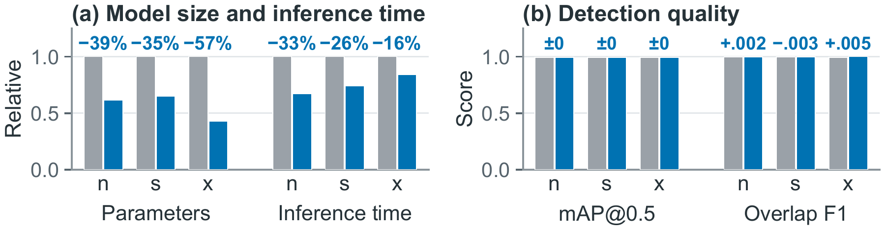
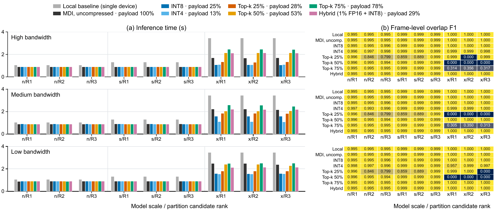

# CEDAR: core experiment results

Results from **[Communication-Efficient Model-Distributed Inference for CBRS Radar
Detection at the Edge](https://arxiv.org/abs/2611.00625)**, submitted to ICC 2027.
The [full paper and appendix](https://arxiv.org/pdf/2611.00625) provide the derivations,
complete comparisons and experimental details. [CSV source data](README.md) remain
available for inspection and analysis.

## Setup and metrics

Training and CEDAR-YOLO architecture-quality evaluation run on a PC GPU.
Local timing and distributed inference run on NVIDIA Jetson Orin Nano **CPUs in FP32**,
with high-, medium- and low-bandwidth environments over Wi-Fi. Local/MDI speed
comparisons use matching Jetson checkpoints; the architecture-quality sweep uses
the later PC checkpoints. See [environments](../README.md#experiment-environments)
and [checkpoint editions](../docs/weights.md).

- **mAP@0.5:** radar/LTE box-detection quality.
- **Overlap F1:** frame-level frequency-overlap detection, with overlap as the positive class.
- **Inference time in the MDI plots:** total run time divided by completed frames,
  the inverse of throughput. It is not individual-frame end-to-end delay.

## 1. Original YOLO: local detection

YOLOv8, YOLO11 and YOLO26 achieve overlap F1 above **0.99** on the held-out test set.
Their multi-scale feature fusion creates multiple tensors across partition boundaries.

[Data](paper/yolo_cpu_detector_results.csv) | [Reproduce](../docs/1_yolo.md)

## 2. CEDAR-YOLO: architecture evaluation

At a 20 x 20 grid and 100% regression coverage, CEDAR-YOLO uses **35-57% fewer
parameters** and **16-33% less model inference time** than same-scale YOLOv8.
mAP@0.5 matches at each model scale, and overlap F1 differs by less than 0.006.

[Data](paper/cedar_yolo_local_comparison_data.csv) | [Reproduce](../docs/2_cedar_yolo.md)

### Feature-grid and regression-coverage sweep

The [complete sweep data](paper/cedar_yolo_sweep_data.csv) cover model scale,
frequency/time grids and regression coverage. The paper and appendix show the
full quality maps and explain the selected configuration.

## 3. Original-YOLO MDI

INT8 compression improves throughput, but multi-tensor boundaries and an
uneven distribution of computation limit scaling. The paper compares the fixed
module-boundary partition with local inference and the flexible CEDAR pipeline.

[Data](paper/yolo_mdi_bandwidth_comparison_data.csv) | [Reproduce](../docs/3_yolo_mdi.md)

## 4. CEDAR-MDI

The top-ranked candidates reach **3.21x** local throughput; the best of the three
candidates reaches **3.27x**, with unchanged overlap F1. The largest improvement
occurs for the extra-large model with INT8. Preprocessing on Node A limits the
nano and small pipelines. Top-k sparsification is unstable across boundaries
and can substantially reduce quality.

Throughput comparisons retain runs within 0.01 overlap F1 of local inference.
The figure displays every candidate, including those with poor quality.
The paper also reports up to **80% less transferred data** than original-YOLOv8 MDI.
End-to-end delay remains a separate metric; its maximum is 7.1 s at the best-throughput
setting and 16.1 s across the quality-retained configurations.

[Data](paper/cedar_yolo_mdi_comparison_data.csv) | [Reproduce](../docs/4_cedar_mdi.md)

## Figure provenance

The two figures above are rendered directly from the paper's current
`cedar_yolo_local_comparison.pdf` and `cedar_yolo_mdi_comparison_compact.pdf`.
The plotted values are unchanged. Refer to the full paper and appendix for figure
numbers and the remaining plots.
